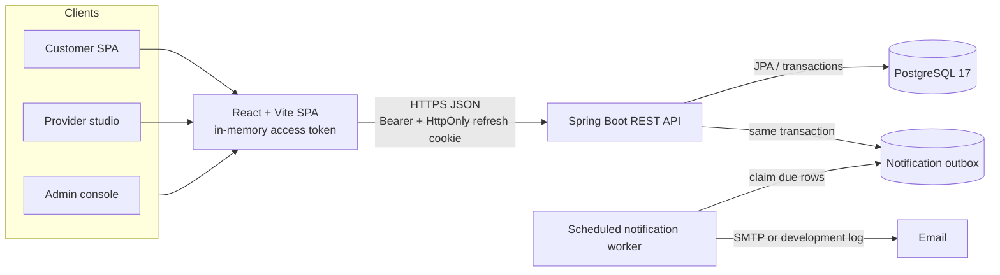
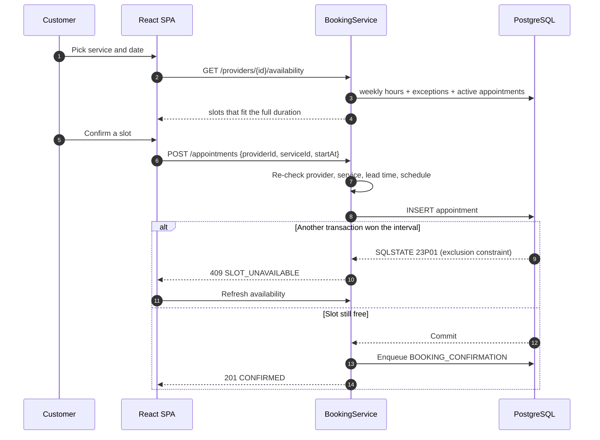
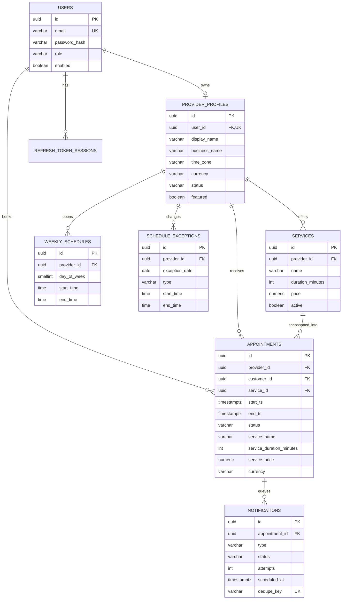

# Bookwell

Bookwell is a full-stack appointment-booking platform for independent service
businesses. It replaces phone tag, messaging threads, and spreadsheet calendars
with real availability, trustworthy bookings, and a single place for customers,
providers, and administrators to work.

The demonstration data is a salon in Bengaluru, but the model is generic enough
for tutors, therapists, and other one-to-one appointment businesses.

> **Status:** complete portfolio implementation, verified locally. It has not
> been deployed to a public URL. Deployment configuration is included and
> documented; see [Deployment](#deployment).

---

## The problem

A small studio usually manages bookings through calls, WhatsApp, and a notebook.
That creates predictable failures:

- Customers cannot tell whether a time is actually free.
- Two people can be promised the same slot.
- Providers have to stop working to answer scheduling messages.
- No-shows and late changes are hard to track.
- There is no reliable reminder trail.

Bookwell makes availability a computed property of the provider's schedule and
existing bookings, then makes overlap impossible at the database level.

## Who uses it

| Role | Main workflow |
|---|---|
| **Customer** | Discover an approved provider, choose a service and a real slot, book, then view, cancel, or reschedule eligible appointments. |
| **Provider** | Apply for a listing, manage services, weekly hours, breaks, closures, extra availability, and a calendar of their own appointments. |
| **Admin** | Approve or suspend providers, search customers, inspect platform bookings, and monitor/retry the notification outbox. |

Provider registration creates a `PROVIDER` account with a `PENDING` profile.
Only admins can approve it for public discovery. Admin accounts cannot be
created through public registration; they are provisioned with environment-based
bootstrap credentials.

## Features

### Public and customer

- Marketing landing page and provider discovery with search, category filter,
  pagination, and accessible empty/error states.
- Provider profiles with services, durations, prices, city, and weekly hours.
- Booking flow: service → date (next 21 days) → live slot → confirmation.
- Customer dashboard with upcoming/history tabs, pagination, appointment detail,
  cancellation, and reschedule dialogs with live availability.
- Server-enforced cancellation cutoff and ownership checks.
- Toast and inline feedback, including automatic availability refresh after a
  `409 SLOT_UNAVAILABLE`.

### Provider studio

- Dashboard counts and today's schedule.
- FullCalendar week/day/month appointment calendar with status-aware actions
  (complete, no-show, cancel, reschedule).
- Service CRUD with archive/deactivate.
- Weekly availability editor supporting multiple intervals per day and breaks.
- Date exceptions: closed all day, blocked period, or extra availability.
- Profile editor including time zone and currency context.

### Administration

- Platform statistics and pending-provider queue.
- Provider search, approval, suspension, and reactivation.
- Customer search and enable/disable access.
- Platform booking ledger with filters and management actions.
- Notification outbox with status/type filters and retry.

### Cross-cutting

- Responsive layouts, keyboard-accessible dialogs/forms, skip link, visible focus
  states, labelled inputs, live regions, and reduced-motion-aware design.
- Loading, empty, error, disabled, and success states throughout.
- OpenAPI/Swagger documentation.
- Idempotent demo seed and a one-time production admin bootstrap.
- Flyway migrations, PostgreSQL constraints, and Testcontainers integration tests.

## Technology

| Layer | Choice |
|---|---|
| Frontend | React 19, TypeScript 7, Vite 8, Tailwind CSS 4 |
| Routing / forms | React Router 7, React Hook Form 7, Zod 4 |
| Server state | TanStack Query 5 |
| Calendar | FullCalendar 6 |
| UI primitives | Radix UI, Lucide, Sonner |
| Backend | Java 21, Spring Boot 3.5, Maven |
| Security | Spring Security, JJWT 0.12, BCrypt, rotating refresh sessions |
| Persistence | Spring Data JPA/Hibernate, PostgreSQL 17, Flyway |
| Email | Spring Mail, persistent notification outbox |
| Tests | JUnit 5, MockMvc, Testcontainers PostgreSQL; Vitest + Testing Library |
| Deployment | Render (Docker + PostgreSQL), Vercel, GitHub Actions |

## Architecture



The frontend is a static SPA. The backend is stateless with respect to access
tokens; refresh-session state lives in PostgreSQL. Flyway is the schema source
of truth and Hibernate runs with `ddl-auto=validate`.

### Booking flow



## Data model



Key database invariants:

- `users.email` is unique and forced lowercase.
- One provider profile per provider user.
- Weekly intervals are non-overlapping per provider/day via a GiST exclusion
  constraint.
- One `CLOSED` exception per provider/date.
- Appointment end must be after start; statuses and cancellation fields are
  checked.
- Active appointments cannot overlap per provider, enforced by PostgreSQL.
- Refresh token hashes and notification dedupe keys are unique.
- Monetary values use `NUMERIC(10,2)`, never floating point.
- Appointment service name, duration, price, currency, and customer contact are
  snapshotted at booking time.

## How double booking is prevented

A service-level availability check is necessary but not sufficient. Two requests
can both see a slot as free before either inserts. Bookwell uses defense in
depth:

1. The booking service re-validates the requested start against the current
   schedule, service duration, lead time, provider status, and availability.
2. The insert happens inside a transaction.
3. PostgreSQL enforces the final invariant:

```sql
ALTER TABLE appointments
    ADD CONSTRAINT appointments_no_overlap
    EXCLUDE USING gist (
        provider_id WITH =,
        tstzrange(start_ts, end_ts, '[)') WITH &&
    )
    WHERE (status IN ('CONFIRMED', 'COMPLETED', 'NO_SHOW'));
```

4. A `23P01` exclusion violation is translated to HTTP `409` with code
   `SLOT_UNAVAILABLE`.
5. The UI refreshes availability so the customer can choose another time.

The range is **half-open** `[start, end)`, so a 10:00–10:45 appointment does not
conflict with one starting at 10:45. Cancelled appointments are excluded from
the predicate and stop blocking the slot. Rescheduling updates the same row, and
the same constraint protects the new interval atomically.

The genuine concurrency proof is
`backend/src/test/java/com/bookwell/booking/BookingConcurrencyIT.java`. It races:

- two customers booking the exact same start time,
- two customers booking non-identical overlapping intervals (10:00 and 10:15
  for a 45-minute service),
- direct concurrent SQL inserts to assert SQLSTATE `23P01`,
- adjacent half-open intervals to assert both bookings succeed.

## Authentication and authorization

- BCrypt password hashing (cost 12), normalized unique emails, password policy
  of 10–72 printable characters with a letter and a number.
- Short-lived JWT access token (15 minutes by default) with a random `jti`,
  kept in memory by the SPA.
- Opaque refresh token in an HttpOnly, Secure-capable, SameSite-configurable
  cookie scoped to `/api/v1/auth`. Only its SHA-256 hash is stored.
- Every refresh rotates the token. Reusing a rotated token revokes the whole
  session family.
- CSRF is enforced on `POST /auth/refresh` and `POST /auth/logout`; the SPA
  obtains a token from `GET /auth/csrf`.
- Login, customer registration, and provider registration have a per-IP
  fixed-window rate limit.
- Role checks exist at both the URL level and method level, and service-layer
  ownership checks prevent cross-tenant access.
- Security headers include CSP, frame denial, HSTS, and a strict referrer policy.
- Production startup fails when JWT, cookies, CORS, SMTP, public URL, or schema
  validation settings are unsafe.
- No secrets are committed; `.env.example` contains placeholders only.

## Local development

### Prerequisites

- Java 21 (`java -version`)
- Node.js 22+ and npm
- Docker Desktop, or a local PostgreSQL 17 server
- No global Maven installation is needed; the wrapper is included.

### 1. Start PostgreSQL

From the repository root:

```powershell
docker compose up -d postgres
```

The development database is `bookwell` on `localhost:5432` with user/password
`bookwell`/`bookwell`. It is defined in `compose.yaml` and is not production
configuration.

### 2. Run the backend with demo data

In PowerShell:

```powershell
cd backend
$env:JAVA_HOME = "C:\path\to\jdk-21"   # only if Java 21 is not already active
$env:APP_ENV = "dev"
$env:DB_URL = "jdbc:postgresql://localhost:5432/bookwell"
$env:DB_USERNAME = "bookwell"
$env:DB_PASSWORD = "bookwell"
$env:MAIL_MODE = "log"
$env:NOTIFICATION_WORKER_ENABLED = "true"
$env:AUTH_COOKIE_SECURE = "false"
$env:SEED_ENABLED = "true"
$env:SEED_ADMIN_EMAIL = "admin@bookwell.demo"
$env:SEED_ADMIN_PASSWORD = "DemoAdmin!2026"
$env:SEED_PROVIDER_EMAIL = "aarohi@bookwell.demo"
$env:SEED_PROVIDER_PASSWORD = "DemoProvider!2026"
$env:SEED_CUSTOMER_EMAIL = "riya@bookwell.demo"
$env:SEED_CUSTOMER_PASSWORD = "DemoCustomer!2026"
.\mvnw.cmd spring-boot:run
```

The equivalent Bash names are the same; use `export NAME=value` and
`./mvnw spring-boot:run`.

Flyway creates the schema on first start. The API listens on
`http://localhost:8080`; health is `/actuator/health`, OpenAPI is
`/v3/api-docs`, and Swagger UI is `/swagger-ui.html`.

Leave `JWT_SECRET` unset in development: an ephemeral random key is generated and
tokens are invalidated on restart. Never use that behavior in production.

### 3. Run the frontend

In a second terminal:

```powershell
cd frontend
npm ci
npm run dev
```

Open `http://localhost:5173`. Vite proxies `/api` to `localhost:8080`, so no
frontend environment variable is needed locally.

### Demo accounts

The seed block above creates three accounts. Passwords are deliberately supplied
through `SEED_*` environment variables, not hardcoded in application source.

| Role | Email | Password (from the block above) |
|---|---|---|
| Admin | `admin@bookwell.demo` | `DemoAdmin!2026` |
| Provider | `aarohi@bookwell.demo` | `DemoProvider!2026` |
| Customer | `riya@bookwell.demo` | `DemoCustomer!2026` |

These are development/demo credentials only. `SEED_ENABLED=true` is rejected
when `APP_ENV=production`.

The seed is idempotent: rerunning it does not duplicate the users, profile,
services, weekly hours, exception, or bookings. It creates:

- the three accounts above,
- an approved “Aarohi Studio” salon in Bengaluru,
- five services (45-minute haircut, 90-minute colour, 60-minute facial,
  30-minute massage, 120-minute bridal makeup),
- Tuesday–Sunday hours of 10:00–13:00 and 14:00–19:00 (a built-in lunch break),
- a future maintenance closure,
- upcoming, completed, and cancelled bookings.

To start from a clean database, stop the app and run
`docker compose down -v` (this deletes the local volume), then start again.

### Seed and administrator provisioning

- `SEED_ENABLED=true` requires all six `SEED_*` email/password values and three
  distinct emails. It is development-only.
- `BOOTSTRAP_ADMIN_EMAIL` + `BOOTSTRAP_ADMIN_PASSWORD` create one admin if that
  email does not already exist. Use this for a real deployment. Remove both
  variables after verifying sign-in.
- There is no public admin registration endpoint.

## Configuration

The canonical backend template is [`.env.example`](.env.example); defaults and
all supported variables are in
[`backend/src/main/resources/application.yml`](backend/src/main/resources/application.yml).
Spring Boot does **not** read `.env` files automatically—export the values or set
them in your host's dashboard.

| Variable | Purpose | Dev default |
|---|---|---|
| `APP_ENV` | `dev` or `production`; controls fail-fast checks | `dev` |
| `DB_URL` | JDBC URL or hosted `postgres://` URI | `jdbc:postgresql://localhost:5432/bookwell` |
| `DB_USERNAME` / `DB_PASSWORD` | Database credentials | `bookwell` / `bookwell` |
| `JWT_SECRET` | Base64 key; at least 32 decoded bytes | ephemeral in dev, required in prod |
| `ACCESS_TOKEN_TTL` / `REFRESH_TOKEN_TTL` | Token lifetimes | `PT15M` / `P14D` |
| `AUTH_COOKIE_SECURE` / `AUTH_COOKIE_SAME_SITE` | Refresh cookie flags | `false` / `Lax` |
| `CORS_ALLOWED_ORIGINS` | Exact comma-separated frontend origins | `http://localhost:5173` |
| `TRUST_FORWARDED_HEADERS` | Use proxy client IP headers; enable behind Render | `false` |
| `DEFAULT_TIME_ZONE` / `DEFAULT_CURRENCY` | New-provider defaults | `Asia/Kolkata` / `INR` |
| `BOOKING_START_INTERVAL_MINUTES` | Candidate grid | `30` |
| `CANCELLATION_CUTOFF` | Customer change window | `PT2H` |
| `BOOKING_MIN_LEAD_TIME` | Minimum notice | `PT30M` |
| `BOOKING_MAX_ADVANCE_DAYS` | Booking horizon | `60` |
| `MAIL_MODE` | `log` in dev, `smtp` in production | `log` |
| `MAIL_*` | SMTP host, port, credentials, sender | blank |
| `NOTIFICATIONS_ENABLED` / `NOTIFICATION_WORKER_ENABLED` | Outbox processing | `true` |
| `REMINDER_LEAD_TIME` | Reminder scheduling | `PT24H` |
| `NOTIFICATION_MAX_ATTEMPTS` | Bounded retries | `5` |
| `SEED_*` | Demo accounts | disabled |
| `BOOTSTRAP_ADMIN_*` | One-time admin | blank |
| `VITE_API_BASE_URL` | Frontend API origin at build time | blank (Vite proxy) |

Production additionally requires `AUTH_COOKIE_SECURE=true`, exact CORS origins,
`MAIL_MODE=smtp`, a non-localhost `MAIL_HOST`, an HTTPS `APP_PUBLIC_URL`, and a
valid `JWT_SECRET`.

## Testing

### Backend

```powershell
cd backend
$env:JAVA_HOME = "C:\path\to\jdk-21"
.\mvnw.cmd test
```

Docker must be running. Tests use a singleton `postgres:17-alpine` Testcontainers
instance, Flyway, a fixed clock (`2027-03-01T00:00:00Z`), and a 15-minute test
grid. They are real Spring integration tests, not H2 substitutes.

The suite verifies:

- registration/login/refresh rotation and role restrictions,
- ownership checks for customers, providers, and admins,
- availability with breaks, closures, blocked periods, extra availability,
  lead time, horizon, inactive services/providers, and past dates,
- 45-minute and other non-grid durations,
- cancellation cutoff, rescheduling, completion, and no-show rules,
- consistent validation/error responses,
- notification creation, dedupe, retry, and lifecycle,
- database exclusion constraints and genuine concurrent overlap races,
- the hosted PostgreSQL URI normalizer and its Spring Boot registration.

Verified at the time of writing: **53 backend tests pass**.

### Frontend

```powershell
cd frontend
npm ci
npm test
npm run lint
npm run build
```

Vitest + Testing Library cover formatting helpers, role routing, the provider
card, and the API client's bearer, refresh-retry, CSRF/logout, typed-error, and
network-error behavior.

Verified at the time of writing: **21 frontend tests pass**, TypeScript and the
production build complete, and oxlint reports advisory warnings only.

### CI

`.github/workflows/ci.yml` runs the backend suite (with Docker/Testcontainers)
and the frontend lint, test, and build jobs on pushes and pull requests.

## API documentation

- Human-readable endpoint reference: [`docs/API.md`](docs/API.md)
- Runtime OpenAPI JSON: `/v3/api-docs`
- Runtime Swagger UI: `/swagger-ui.html`

All endpoints are under `/api/v1`. Errors use a consistent body with
`timestamp`, `status`, `code`, `message`, `path`, and optional `fieldErrors`.
Booking conflicts return `409 SLOT_UNAVAILABLE`; validation returns
`400 VALIDATION_FAILED`; authorization failures return `403`.

## Deployment

The full guide is [`docs/DEPLOYMENT.md`](docs/DEPLOYMENT.md). Summary:

- **Backend + database:** [`render.yaml`](render.yaml) defines a Docker web
  service and Render PostgreSQL. Flyway migrates on startup.
- Hosted `postgresql://` URIs are converted to JDBC URLs by a tested
  `EnvironmentPostProcessor`; they are not pasted blindly into a Spring
  datasource property.
- The service uses `/actuator/health`, an exact CORS origin, secure
  SameSite=None refresh cookies, a generated JWT secret, and one-time bootstrap
  admin credentials.
- **Frontend:** deploy `frontend/` to Vercel with `VITE_API_BASE_URL` set to the
  Render API. `vercel.json` handles SPA rewrites and baseline headers.
- **Email:** production requires SMTP and fails fast otherwise. Render free
  instances sleep, so timed reminders are not reliable without an always-on
  instance or external wake-up.
- **CI:** Render can deploy only after GitHub checks pass.

No public deployment URL is claimed. Deployment was not executed here.

## Project structure

```text
bookwell/
├── backend/
│   ├── src/main/java/com/bookwell/
│   │   ├── auth/              JWT, refresh sessions, CSRF, auth endpoints
│   │   ├── availability/      dynamic slot generation
│   │   ├── booking/           lifecycle, conflicts, rescheduling
│   │   ├── schedule/          weekly hours and exceptions
│   │   ├── provider/          catalog, services, profile management
│   │   ├── admin/             approval, customers, platform views
│   │   ├── notification/      outbox, worker, SMTP/log gateways
│   │   ├── seed/              idempotent demo data + admin bootstrap
│   │   ├── config/            security, properties, validation, rate limit
│   │   └── common/            errors, pagination, security helpers
│   ├── src/main/resources/
│   │   ├── db/migration/      Flyway schema
│   │   └── application.yml
│   ├── src/test/java/         integration + unit tests
│   └── Dockerfile
├── frontend/
│   ├── src/
│   │   ├── auth/              session context and guards
│   │   ├── components/        layouts and reusable UI
│   │   ├── lib/               API client, formatting, forms
│   │   ├── pages/             public, customer, provider, admin
│   │   └── types/             API contracts
│   ├── vercel.json
│   └── vite.config.ts
├── docs/API.md
├── docs/DEPLOYMENT.md
├── .env.example
├── compose.yaml
├── render.yaml
└── .github/workflows/ci.yml
```

## Design decisions and trade-offs

- **Database-enforced overlap prevention** instead of JVM locks or serializable
  retries. This is correct across processes and instances.
- **Dynamic slot generation** instead of persisting every possible slot. This
  keeps schedule edits and exceptions authoritative.
- **Half-open intervals** so adjacent appointments are allowed.
- **Snapshotted service data** so later price/duration edits do not rewrite
  history.
- **Refresh-token families** so theft/reuse can revoke an entire session.
- **Outbox + worker** so mail failure cannot roll back a booking. Delivery is
  at-least-once; duplicates are possible only in a crash window after SMTP
  accepts a message but before the row is marked sent.
- **Provider-local schedules, UTC instants** for correct DST behavior.
- **In-memory access tokens** to reduce XSS token theft impact; refresh state is
  persisted only as hashes.
- **Single-staff provider model**, matching the agreed scope.

## Known limitations

- The app is not publicly deployed; Render/Vercel instructions are prepared but
  unexecuted.
- Email delivery is at-least-once. There is no distributed exactly-once guarantee
  across an SMTP handoff.
- The login rate limiter is in-memory per instance. A multi-instance deployment
  needs a shared store (for example Redis) for a global limit.
- Render free web instances sleep. Reminder timing is unreliable without an
  always-on instance or external scheduler.
- Render free-tier databases and web services have plan limits (including
  expiry/suspension). Use a paid plan for long-lived production data.
- Reminders and notifications depend on the worker; `NOTIFICATION_WORKER_ENABLED`
  can be disabled for local debugging, leaving outbox rows pending by design.
- There is no email verification, password reset, or self-service account
  deletion.
- No payments, SMS/WhatsApp, reviews, waitlists, calendar sync, analytics, dark
  mode, i18n, white-label, multi-staff calendars, or social login.
- Administrators are provisioned operationally; there is no admin user-management
  screen beyond customer enable/disable.

## License

No license has been added. Treat the repository as a portfolio project unless a
license is provided.
